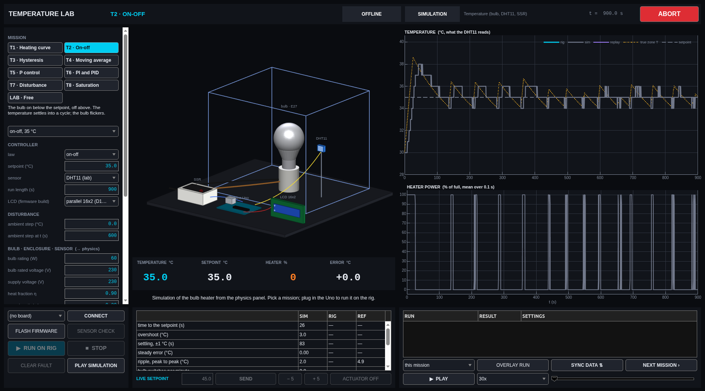
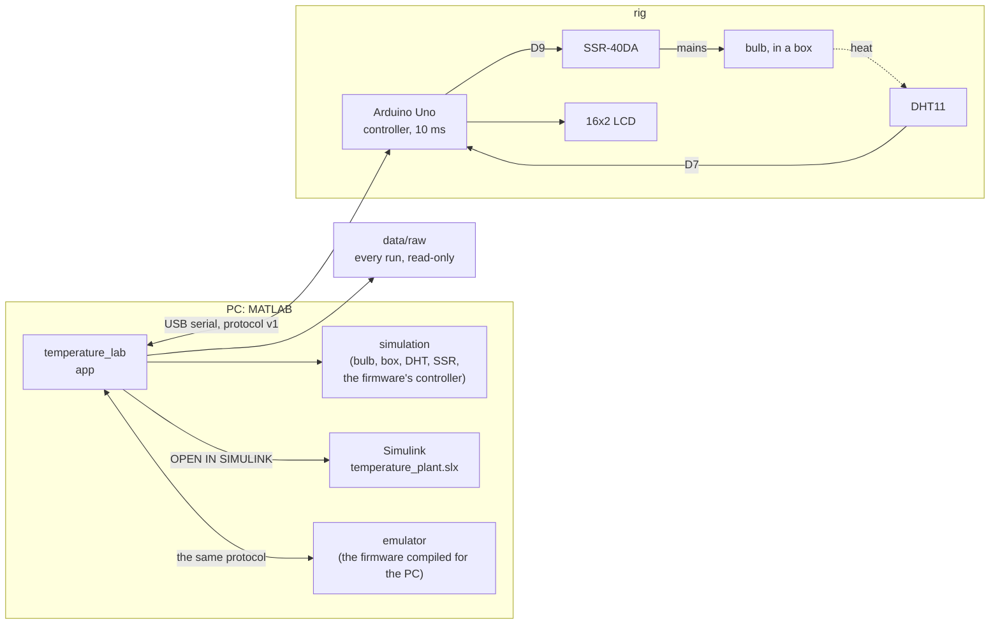

# Arduino temperature control lab: bulb heater, DHT11, solid-state relay, MATLAB and Simulink

**On-off, hysteresis, moving-average, P, PI and PID temperature control of a bulb-heated box
with an Arduino Uno, a DHT11 and an SSR: firmware, a MATLAB lab app whose physics comes from
your bulb and your box, a Simulink model, and an end-to-end test against an emulated rig.**

[](https://github.com/Samarth030312/arduino-temperature-control-lab/actions/workflows/ci.yml)


A light bulb heats a closed box. A DHT11 measures the air in it, once a second and in whole
degrees. An Arduino switches the bulb through a solid-state relay and decides how much heat
to give: on-off, with hysteresis, on a moving average, or proportional, PI or PID. A MATLAB app
simulates every one of these from the physics of the bulb, the box and the sensor you describe,
runs the same controller on the rig, records it and draws one over the other.

If you are building this rig, this repository takes you from parts to a measured control loop.
If you are not, the simulator and the Simulink model teach the same control ideas: dead time,
a slow first-order plant, a coarse and late sensor, actuator limits and windup.

<p align="center"></p>

## Get it running

Paste this into the MATLAB Command Window, on Windows, macOS or Linux (MATLAB R2023b or newer):

```matlab
gitclone("https://github.com/Samarth030312/arduino-temperature-control-lab.git", Depth=1); cd arduino-temperature-control-lab; setup open
```

It downloads the repository, checks the computer, installs the project's own Arduino toolchain
the first time (about 60 MB, hash-checked, no admin rights) and opens the app. The simulator
needs only MATLAB. Terminal one-liners and the CH340 driver: **[install](install/README.md)**.
Then, step by step: **[the sequence](docs/SEQUENCE.md)**.

> **The bulb runs on mains voltage.** The low-voltage side (Arduino, DHT11, LCD, the SSR's input)
> is safe to wire; the mains side must be built or checked by someone qualified, in a closed
> enclosure. [Wiring and safety](docs/hardware/WIRING.md).

## What the model says, before the rig

With the default rig (a 60 W bulb in a 30 cm box, ESTIMATED until you measure yours):

- **The plant is slow and simple.** A rise of about 54 °C at full power, a time constant of
  about 150 s and about 13 s of effective dead time (3 s from bulb to sensor, the rest the
  DHT11's own lag); the sensor adds a 1 °C staircase, updated once a second.
- **On-off works, with a ripple.** At 35 °C it holds about 2 °C peak to peak, the bulb
  switching about four times a minute; hysteresis halves the switching and widens the band.
- **A moving average over 10 samples does nothing** when the sensor only changes once a second:
  the controller runs every 10 ms, the DHT11 does not.
- **P leaves an offset**, smaller as Kp grows, until Kp is so large that P is on-off again.
- **An integrator winds up** when the heater is limited; clamping fixes it.

Rig sessions will be added under [results](results/README.md); every number above will then be
checked against the rig, as in the [DC servo lab](https://github.com/Samarth030312/rhino-rmcs-2303-dc-servo-control).

## Start here

| I want to … | Go to |
|---|---|
| understand the simulator, Simulink, the emulator and the rig | [how it works](docs/HOW_IT_WORKS.md) |
| run everything, in order | [the sequence](docs/SEQUENCE.md) |
| install it on Windows, macOS or Linux | [install](install/README.md) |
| use the app, no hardware needed | [the app guide](docs/guide/README.md) |
| run the Simulink model | [Simulink](docs/SIMULINK.md) |
| build and wire the rig | [replicate the rig](docs/REPLICATE.md) and [wiring](docs/hardware/WIRING.md) |
| understand the physics | [first principles](docs/FIRST_PRINCIPLES.md) |
| read the results | [results](docs/RESULTS.md) |
| use the data | [data](data/README.md) |
| fix a problem | [troubleshooting](docs/TROUBLESHOOTING.md) |
| follow the ENR312 course (Ahmedabad University) | [course guide](docs/course/README.md) |
| see what comes next | [roadmap](ROADMAP.md) |

## How it fits together



## Status

- **Firmware:** every mode (on-off, hysteresis, moving average, P, time-proportioning, heater
  step, PI), LCD parallel or I2C, a 70 °C cut-off and a sensor-failure cut-off; compiles in CI
  on Windows, macOS and Linux; runs against an emulated bulb, box and DHT11.
- **App and Simulink:** missions T1–T8 and LAB, end-to-end tested against the emulated rig.
- **Not yet on a real rig.** The physics values are ASSUMED until you measure your bulb and box.

## Repository layout

```
setup.m      one command: path, checks, toolchain, the app (setup open)
firmware/    the Arduino sketch, the LCD example, and the sketch compiled for the PC against an emulated rig
matlab/      app, physics, controller, metrics, the Simulink model, tests
data/        every rig run (raw CSV, metadata, RUN_REGISTER.csv)
results/     reports and figures
docs/        how it works, physics, hardware, guide, course guide, knowledge base
install/     one-line set-up for Windows, macOS, Linux
```

## Related

Same lab family, same app design: [Rhino DC servo lab](https://github.com/Samarth030312/rhino-rmcs-2303-dc-servo-control) ·
[Arduino water level control lab](https://github.com/Samarth030312/arduino-water-level-control-lab) ·
[STEVAL-EDUKIT01 rotary inverted pendulum](https://github.com/Samarth030312/steval-edukit).

## License

MIT ([`LICENSE`](LICENSE)). Arduino libraries are installed at pinned versions, not
redistributed ([`THIRD_PARTY.md`](THIRD_PARTY.md)). Course handouts are cited, not redistributed.
