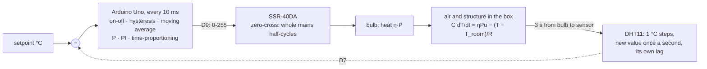
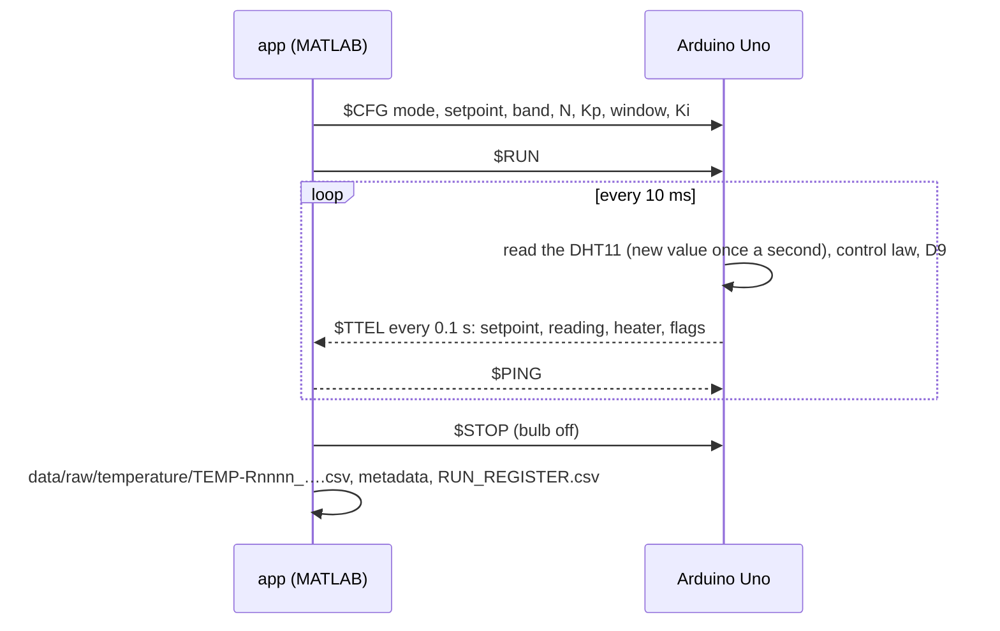

# How it works

Four things can run the same experiment: the **simulator** in the app, the **Simulink**
model, the **emulator** (the real firmware compiled for the PC), and the **rig**.

## The loop

Three things make this plant interesting for control, all of them in the model:

- **It is slow and can only heat.** Cooling is the room's job; the controller's output is 0 to
  full power, never negative.
- **The sensor is coarse and late.** The DHT11 gives whole degrees, refreshed once a second,
  behind its own thermal lag. A controller running every 10 ms mostly sees the same number.
- **The actuator is a mains switch.** A zero-crossing SSR can only pass whole half-cycles, so a
  fast PWM on pin 9 becomes a flicker of the bulb, not a smooth power. Time-proportioning
  (on for a fraction of a 2 s window) gives the same average power without the flicker.

## Four ways to run one experiment

| | What it is | Use it to |
|---|---|---|
| **Simulator** | MATLAB, inside the app: the bulb and box from the physics panel, the DHT11's lag, update and resolution, the SSR's average power, and the firmware's controller laws | learn the concepts without hardware; predict a rig run |
| **Simulink** | `temperature_plant.slx`, generated from code; **OPEN IN SIMULINK** builds it with the app's settings | see and change the block diagram ([Simulink](SIMULINK.md)) |
| **Emulator** | the sketch compiled with g++ against an emulated bulb, box and DHT11, in real time on a pseudo-terminal (faster than real time on request) | test the firmware and the app together without a rig; CI does |
| **Rig** | the Uno, the SSR, the bulb in its box, the DHT11, the LCD | measure |

## A run, from button to file

Safety in the firmware, independent of the PC: the bulb starts off and runs only after RUN (or
the button on D8); a hard cut-off at 70 °C; a cut-off after 5 s without a valid sensor reading;
the bulb off if the PC is silent for 3 s. Protocol: [serial protocol](architecture/SERIAL_PROTOCOL.md).
