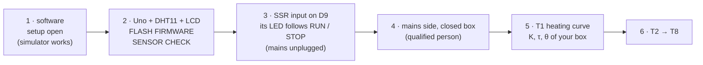

# Replicate the rig

## Parts

| Part | What the lab uses | Notes |
|---|---|---|
| Controller | Arduino Uno (a CH340 clone works; Windows needs its driver, see [install](../install/README.md)) | |
| Sensor | **DHT11** (DHT22 supported: build with `-DDHT_KIND=DHT22`) | a 3-pin module has the 10 kΩ pull-up |
| Relay | solid-state relay, 3–32 V DC input, AC output (SSR-40DA type) | confirm the input range and whether it is zero-crossing on your relay's label |
| Heater | an incandescent or halogen bulb (60 W in the defaults) in a lamp holder | an LED bulb barely heats (η ≈ 0.3) |
| Enclosure | a closed box (30 × 30 × 30 cm in the defaults), not flammable near the bulb | its walls set the heat loss |
| Display | 16x2 LCD, parallel or with an I2C backpack | choose the type in the app before flashing |
| Mains | a fused, earthed lead into a closed enclosure, built or checked by someone qualified | **the bulb side is mains voltage** |
| PC | Windows, macOS or Linux, MATLAB R2023b or newer (Simulink optional) | |

## Build, in this order

1. `setup open`; play the missions in simulation.
2. Low-voltage side only: DHT11 on D7, the LCD ([wiring](hardware/WIRING.md)). Choose the LCD type
   under CONTROLLER, **FLASH FIRMWARE**, CONNECT, **SENSOR CHECK**: a sensible room temperature.
3. The SSR's input on D9 and GND, mains **unplugged**: RUN in T2 at a setpoint above room
   temperature lights the SSR's LED; STOP turns it off.
4. The mains side, inside the closed enclosure, by someone qualified. Lid closed, then plug in.
5. **T1**, the heating curve: the bulb fully on, then off. Read K, τ and θ in the table; enter
   your box's dimensions and the bulb's rating in the physics panel until SIM matches RIG.
6. T2 to T8 ([the sequence](SEQUENCE.md)). Every run is saved and registered.

Before any run with mains: [experiment checklist](safety/EXPERIMENT_CHECKLIST.md) and
[electrical safety](safety/ELECTRICAL_SAFETY.md).
