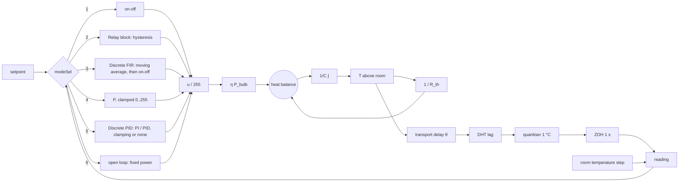

# Simulink model

`matlab/models/temperature/temperature_plant.slx`, generated by `build_temperature_simulink`
(so it can be reviewed, diffed and rebuilt). Parameters live in the **model workspace** and are
set by `run_temperature_simulink(cfg)` from the same configuration the app simulates.

## From the app

**OPEN IN SIMULINK** builds the model with the current mission's controller, setpoint, gains
and the physics panel's K, τ, θ and sensor, and opens it. Run it; change blocks freely; rebuild
with the button to get the app's version back.

## From a script

```matlab
setup
c = templab.temperature.defaultConfig();           % the physics panel's defaults
c.mode = 'PI'; c.setpoint = 45; c.Kp = 50; c.Ki = 0.5; c.Tend = 1500;
c.ssr = 'average';                                 % Simulink models the SSR's average power
R = run_temperature_simulink(c);                   % Simulink
S = templab.temperature.simulate(c);               % the same loop in MATLAB
```

`matlab/tests/test_simulink_model.m` runs on-off, hysteresis, moving average and P in both and
checks they agree: mean reading within 0.3 °C, heater duty within 3 %, the heating phase within 0.05 °C.

## Blocks



The SSR is modelled by its average power; the MATLAB simulation can also model the 490 Hz PWM
against a zero-crossing relay (the flicker), Simulink does not.

For the ENR312 Simulink assignments on temperature, see the [course guide](course/README.md).
