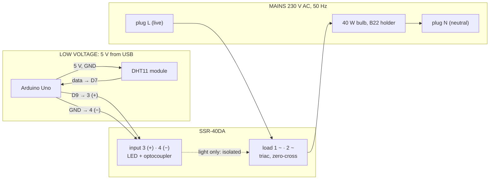

# Wiring: bulb, SSR, DHT11, Arduino Uno

The lab rig: a **Philips clear 40 W incandescent bulb** (230 V, 415 lm) in a **B22** bayonet
holder, a **Fotek SSR-40DA** solid-state relay (input 3–32 V DC, output 24–380 V AC), a
**DHT11** module, an **Arduino Uno** on USB. No display on the board: the MATLAB app shows
everything. Firmware: `firmware/temperature_controller/`.

> **The bulb side is 230 V mains and can kill.** Wire it with the plug out of the socket, have it
> checked by the lab technician or the instructor before the first power-up, and never touch the
> bulb side, the SSR's load screws or the bulb while it is plugged in. The SSR does not isolate the
> bulb when it is off (section 3).

## 1. Two circuits, joined only through the SSR



## 2. Low-voltage side (first, with the mains plug out)

| From | To on the Uno | Notes |
|---|---|---|
| SSR **3 (+)** (input, marked `+`) | **D9** | The firmware sets it HIGH (5 V) to switch the bulb on. The SSR's input draws a few mA, well inside a pin's 20 mA. |
| SSR **4 (−)** (input, marked `−`) | **GND** | Any GND pin. On the top header, the pin next to D13 is GND and the one beyond it is **AREF**: not AREF. |
| DHT11 module **+** (VCC) | **5V** | Read the labels printed on the module: `+` or `VCC`, `−` or `GND`, `S`, `OUT` or `DATA`. The order differs between makers. |
| DHT11 module **−** (GND) | **GND** | |
| DHT11 module **S / OUT / DATA** | **D7** | The module has its own pull-up resistor; nothing else is needed. |
| optional push-button | D8 and GND | Start and stop without MATLAB; leave it out if not used. |

Check it before any mains is connected: in the app, **FLASH FIRMWARE**, then **CONNECT**. The
room temperature appears. **RUN** with a setpoint above it lights the SSR's LED; **STOP** puts it
out. The LED shows the input only: it does not prove the mains side.

## 3. Mains side (plug out; checked by someone qualified before power-up)

The SSR switches the **live** wire, in series with the bulb:

```
   plug L (live) ── SSR 2 ~ ║ SSR 1 ~ ── bulb holder (one wire) ── bulb ── bulb holder (other wire) ── plug N (neutral)
                            ║   the SSR's AC terminals have no polarity: 1 and 2 may be swapped
```

- **Live, not neutral, through the SSR.** With the SSR in the neutral, the holder stays at 230 V
  even with the bulb dark. On the lab rig both plug wires are blue, so colour cannot tell which is
  live: open the plug, follow the wire from the terminal marked **L** to the SSR, and mark it. A
  socket can be wired the wrong way round too: the technician checks with a tester that the holder
  is not live while the bulb is off.
- **Even off, the SSR leaks up to 3 mA** (its datasheet): the bulb stays dark but the circuit is
  not dead. Unplug before touching the bulb side, always.
- **Joints in a terminal block or lever connectors, not twisted and taped.** No exposed copper,
  nothing that can pull apart. The joints, the SSR and the holder's wire ends belong on a board or
  in a box, away from the Uno and the laptop.
- **Protection:** a switched extension board with a fuse or MCB, and an RCD/RCCB if the lab has
  one. The bulb draws 0.17 A; a 1 A fuse in the live wire is enough. Switching on, the cold
  filament draws about 3 A for a few milliseconds (its resistance is 10–15 times lower cold):
  far inside the SSR's rating.
- The SSR's clear cover stays on. Its screws clamp bare strands, twisted tight, none sticking out.
- The plug's earth pin is not used: the holder is plastic, and the SSR's metal plate is
  insulated from its terminals.

## 4. Where the DHT11 goes

**Not on the bulb.** The DHT11 is specified for 0–50 °C; the glass of a 40 W bulb runs well above
100 °C. Taped to it, the sensor reads out of range, its plastic can soften, and it measures the
glass instead of the air. Tape also lets go of hot glass.

- **In the air beside the bulb, about 5 cm from the glass, level with its widest part**, on a
  stand or a stiff wire, touching nothing hot.
- **The blue perforated face towards the bulb.** The sensing element sits behind the grille; the
  back is the circuit board.
- **Inside a closed box with the bulb** (the model's default is 30 × 30 × 30 cm; cardboard or
  wood, the bulb at least 5 cm from every wall). The box makes runs repeatable (no drafts) and
  lets the 55 °C setpoint be reached. Measured on the lab rig (run TEMP-R0001, sensor about
  5 cm from the glass): full power settles about 32 °C above the room, near 56 °C from a 24 °C
  room, so 55 °C is only just reachable. In open air the reading depends on drafts and on the
  exact distance.
- Then measure instead of guessing: mission **T1** heats with the bulb fully on to 50 °C and
  records the cooling; the app fits K, τ and θ to it. If the reading passes 50 °C within a
  minute, move the sensor further away.

The firmware switches the bulb off at **60 °C** (DHT11; 70 °C with a DHT22), after **5 failed
reads in a row** (10 s; single failed reads are normal and ignored), and when MATLAB is silent
for **3 s**. Each of these stops is reported to the app. Above 50 °C the DHT11 is outside its
datasheet: runs at a 55 °C setpoint are valid as an experiment, but say so in a report.

## 5. Bring-up order

1. Low voltage only (section 2), mains unplugged: FLASH FIRMWARE, CONNECT, room temperature.
2. RUN with a setpoint above room temperature: SSR LED on. STOP: off.
3. Mains side wired and checked (section 3); the sensor placed (section 4); the box closed.
4. Plug in. Mission T1, watching the whole first heating.
5. Then the missions in order ([the sequence](../SEQUENCE.md)).
