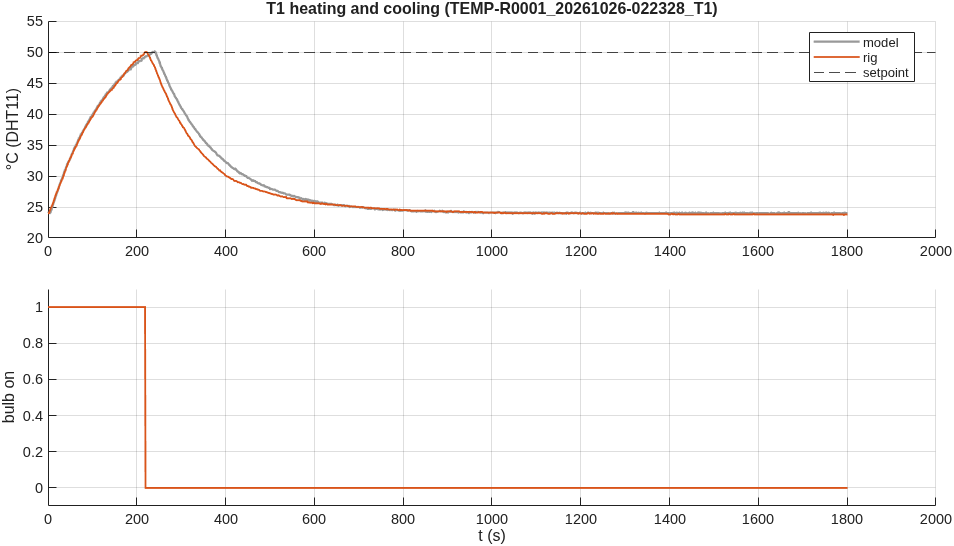
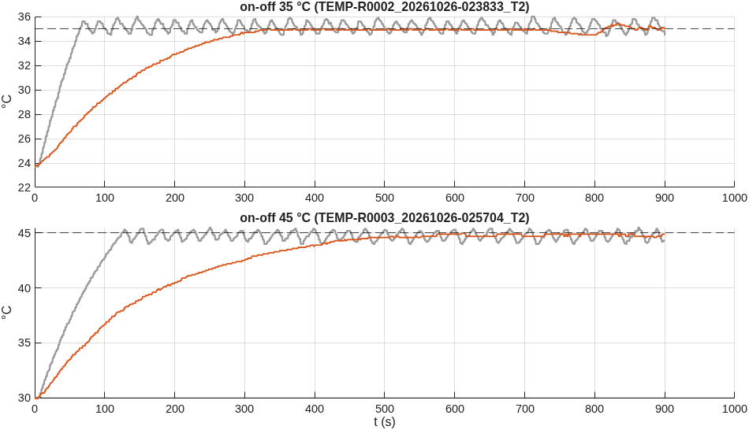

# Temperature control: rig session 2026-10-26

Generated by `matlab/scripts/temperature_session_report.m` from `data/` (4 runs from 01:50 to 03:13). Philips 40 W bulb through a Fotek SSR-40DA, DHT11 read every 2 s, Arduino Uno. Grey in every figure is the model fitted to this session's T1 run, running each run's own settings.

**Observation.** The rig changed between the T1 heating (01:53-01:57) and T2 (02:23): with the bulb fully on, the reading rose at 0.065 °C/s instead of T1's 0.18 °C/s and levelled off near 37 °C (T2 at 35 °C) and 45-46 °C (T2 at 45 and 55 °C) instead of about 56 °C, and cooled about three times slower. The firmware drives the SSR identically in both modes, so the change is physical (sensor position or the box); it was not recorded. The model in grey is fitted to T1 and therefore overestimates the T2 runs. TEMP-R0004 (on-off at 55 °C, stopped by the operator at 550 s at 46.1 °C) is the full-power heating curve of the changed rig.

## T1 Heating and cooling: the plant
Plant identified on `TEMP-R0001_20261026-022328_T1`. Room **24.0 °C**. Bulb fully on for the first 220 s (up to 50.0 °C), then off for the rest of the run. Fit of tau dT/dt = K u(t - theta) - (T - Ta) to the whole record (heating and cooling together, so no final value has to be guessed): **K = 31.9 °C at full power, tau = 138 s, theta = 5 s** (RMSE 0.31 °C). At full power the reading would settle near 56 °C. Heating starts at 0.18 °C/s, cooling at -0.17 °C/s. Cooling is slower: heating is driven by the full rise K = 32 °C, cooling only by the 26 °C above the room, and it slows further as the box approaches room temperature.

The sensor: a new value every 2.0 s (the firmware reads every 2 s; the datasheet asks for > 2 s), smallest step seen 0.1 °C (this DHT11 reports tenths; its datasheet states 1 °C).

## T2 On-off
| setpoint (°C) | swing, rig (°C) | period, rig (s) | switches / min | swing, model | period, model | run |
|---:|---:|---:|---:|---:|---:|---|
| 35 | 0.9 | 24 | 5.1 | 1.6 | 26 | `TEMP-R0002_20261026-023833_T2` |
| 45 | 0.4 | 80 | 1.4 | 1.5 | 25 | `TEMP-R0003_20261026-025704_T2` |

Swing and period are measured once the reading has first reached the setpoint. The bulb switches when the reading crosses the setpoint, but the temperature keeps moving for the dead time theta and the sensor's lag before the reading turns: that sets the swing. Above 50 °C the DHT11 is outside its datasheet.

## Runs stopped by the firmware
- `TEMP-R0004_20261026-031220_T2` on-off, 55 °C: ABORTED: by the operator
