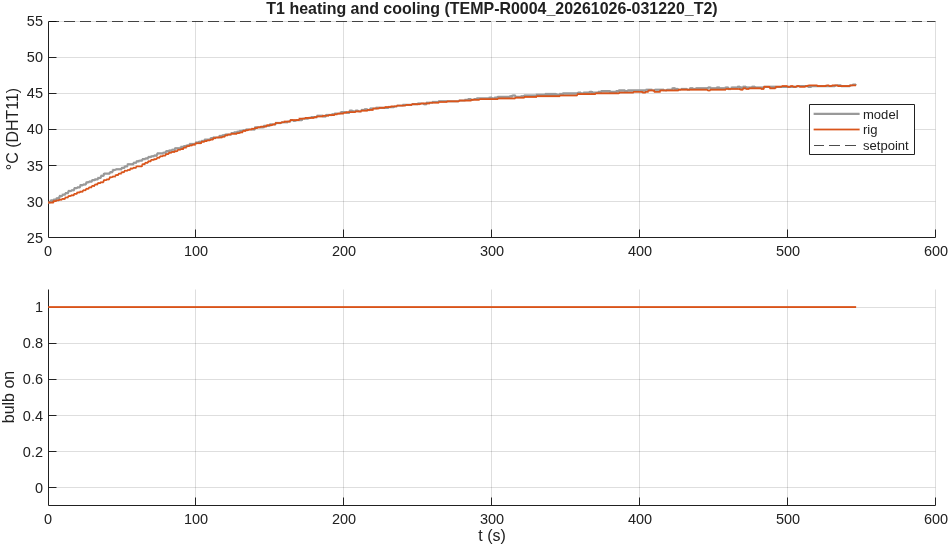
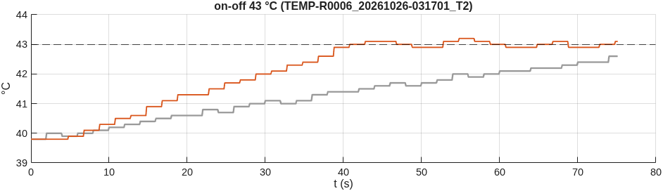
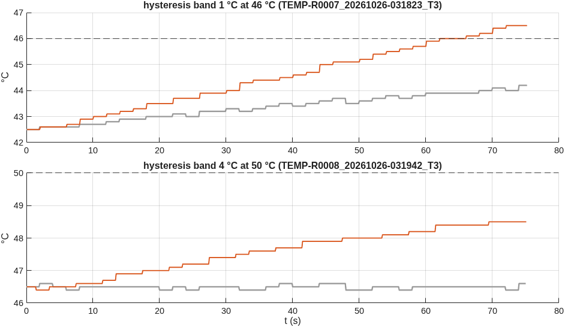
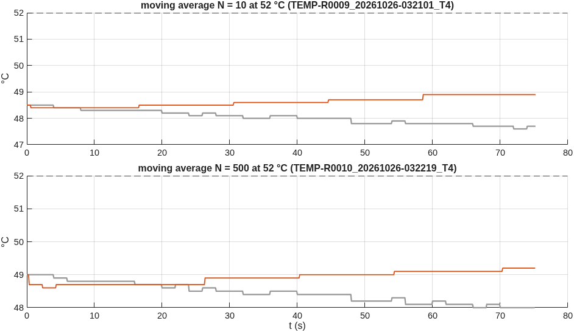
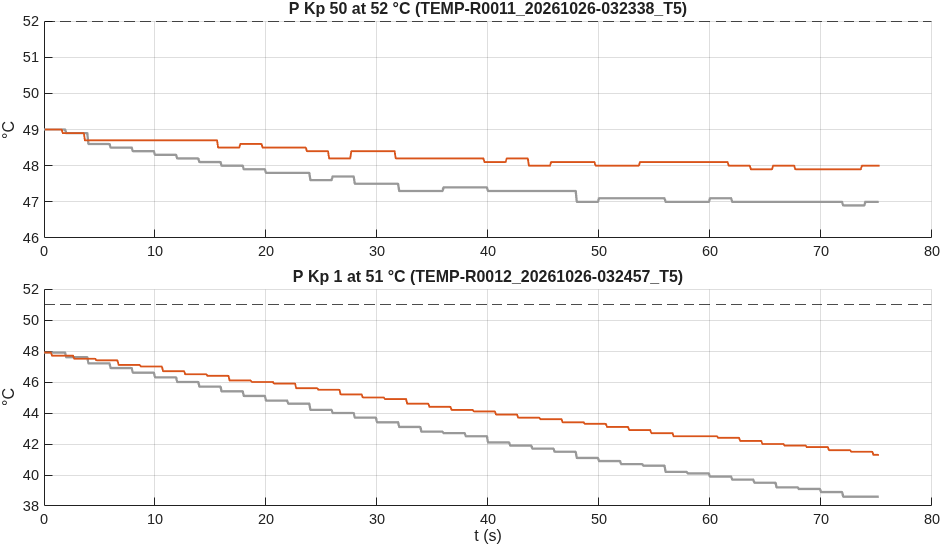
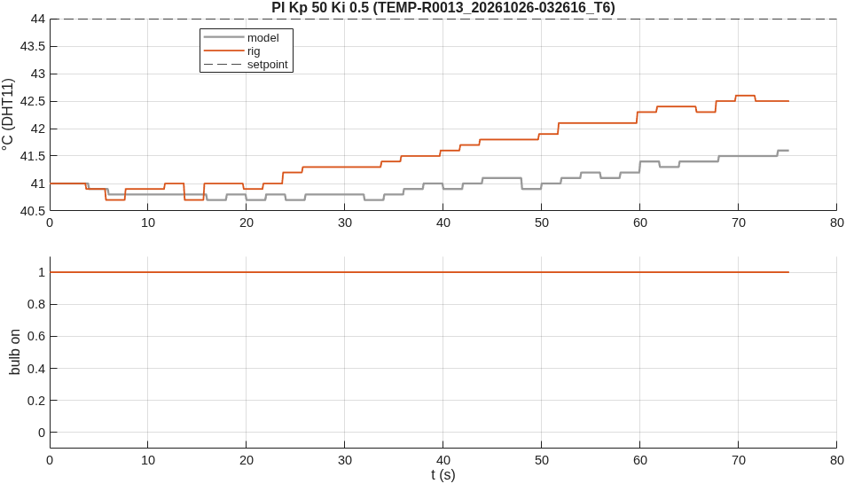

# Temperature control: rig session 2026-10-26

Generated by `matlab/scripts/temperature_session_report.m` from `data/` (9 runs from 03:14 to 03:27). Philips 40 W bulb through a Fotek SSR-40DA, DHT11 read every 2 s, Arduino Uno. Grey in every figure is the identified model (section T1), running each run's own settings.

**Observation.** Short runs: 75 s each, back to back without cooling, each setpoint 3 °C above the reading at the start of its run (temperature_rig_campaign ... 'Tend', 75, 'SpAbove', 3), so every controller acts in its first minute. The runs start warm (36.7-49.2 °C) and are shorter than the plant's time constant: they show each controller's switching and its first approach to the setpoint, not settled values; a dash marks a quantity the run did not last long enough to show. The 75 s T1 run cannot identify the plant, so the model is fitted to TEMP-R0004 (550 s at full power from 29.9 °C, two minutes before this session) with the room at 24.0 °C, measured at 01:53.

## T1 Heating and cooling: the plant
Plant identified on `TEMP-R0004_20261026-031220_T2`. Room **24.0 °C**. Bulb fully on for the first 546 s (up to 46.1 °C), then off for the rest of the run. Fit of tau dT/dt = K u(t - theta) - (T - Ta) to the whole record (heating and cooling together, so no final value has to be guessed): **K = 22.4 °C at full power, tau = 143 s, theta = 0 s** (RMSE 0.33 °C). At full power the reading would settle near 46 °C. Heating starts at 0.09 °C/s, cooling at - °C/s. 

The sensor: a new value every 2.0 s (the firmware reads every 2 s; the datasheet asks for > 2 s), smallest step seen 0.1 °C (this DHT11 reports tenths; its datasheet states 1 °C).

## T2 On-off
| setpoint (°C) | swing, rig (°C) | period, rig (s) | switches / min | swing, model | period, model | run |
|---:|---:|---:|---:|---:|---:|---|
| 43 | 0.3 | 10 | 10.5 | - | - | `TEMP-R0006_20261026-031701_T2` |

Swing and period are measured once the reading has first reached the setpoint. The bulb switches when the reading crosses the setpoint, but the temperature keeps moving for the dead time theta and the sensor's lag before the reading turns: that sets the swing. Above 50 °C the DHT11 is outside its datasheet.

## T3 Hysteresis
| setpoint (°C) | band (°C) | swing, rig (°C) | switches / min, rig | swing, model | switches / min, model | run |
|---:|---:|---:|---:|---:|---:|---|
| 46 | 1 | 0.0 | - | - | - | `TEMP-R0007_20261026-031823_T3` |
| 50 | 4 | - | - | - | - | `TEMP-R0008_20261026-031942_T3` |
The bulb switches on below setpoint - band/2 and off above setpoint + band/2: a wider band, fewer switches and a wider swing. With 0.1 °C sensor steps every 2 s, a band under about 0.2 °C acts as on-off.

## T4 Moving average (Ts = 10 ms)
| N | window (s) | sensor values in it | delay (N-1)Ts/2 (s) | overshoot, rig (°C) | switches / min, rig | run |
|---:|---:|---:|---:|---:|---:|---|
| 10 | 0.10 | 1 | 0.045 | - | - | `TEMP-R0009_20261026-032101_T4` |
| 500 | 5.00 | 3 | 2.495 | - | - | `TEMP-R0010_20261026-032219_T4` |

With a new sensor value only every 2 s, a window of 10 samples (0.1 s) almost always holds one value: it filters nothing. 500 samples (5 s) hold two or three values: the switching point moves between them, and the filter adds about 2.5 s of delay, which widens the swing.

## T5 P control
Steady error predicted for a first-order plant with gain K: e = (r - Ta) / (1 + K Kp / 255), with K = 22.4 °C at full power and Ta = 24.0 °C. It needs the run to be several tau long; a shorter run is still on its way.

| mode | setpoint (°C) | Kp | steady error, rig (°C) | predicted (°C) | light changes / min | run |
|---|---:|---:|---:|---:|---:|---|
| P | 52 | 50 | 3.99 | 5.19 | 1 | `TEMP-R0011_20261026-032338_T5` |
| P | 51 | 1 | 8.55 | 24.82 | 1 | `TEMP-R0012_20261026-032457_T5` |

The SSR switches only at the mains zero crossings, every 10 ms. Driven by the 490 Hz PWM of pin 9, it samples the PWM at each crossing: for u = 128 the bulb gets a pseudo-random half of the half-cycles, not a steady half power. That is the flicker near e = 0. Time-proportioning (on for u/255 of a 2 s window) gives the same mean power with far fewer light changes.

## T6 PI
PI (Kp 50, Ki 0.5, clamping anti-windup) at 44 °C: mean error over the last 40 % of the run **1.79 °C**, overshoot - °C (`TEMP-R0013_20261026-032616_T6`).

## Runs stopped by the firmware
None.
